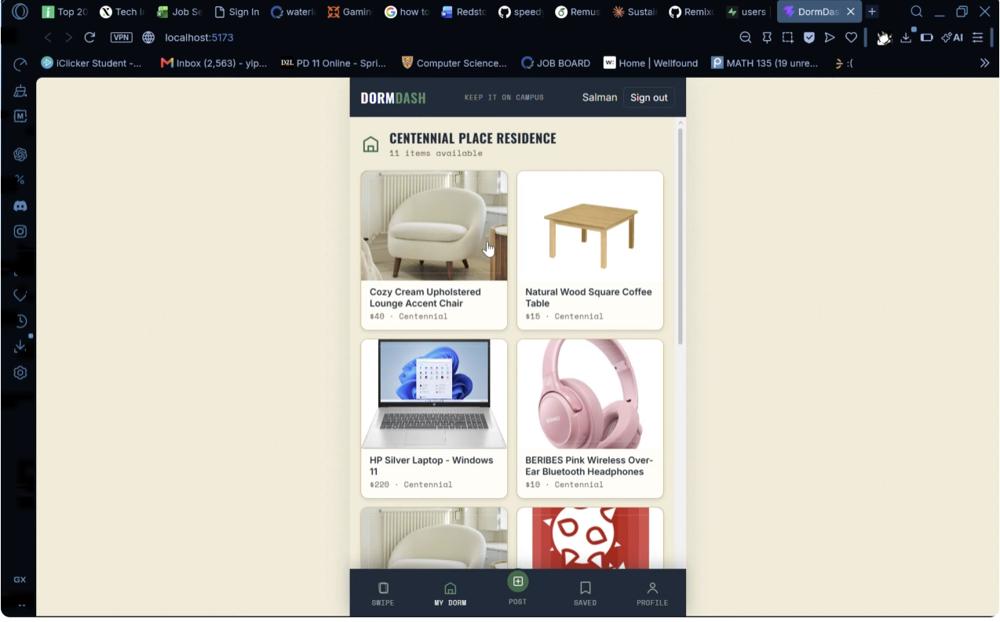

# 🛏️ DormDash

**Snap a photo, skip the landfill. A sustainable campus marketplace where AI turns one photo into a complete listing.**

College students buy, replace, and throw away items every semester. DormDash makes reselling or giving away an item as effortless as throwing it in the trash, by connecting students within the same dorm and removing the friction of travel.

**[▶ Watch the demo](https://www.youtube.com/watch?v=kRUrI3VKvqw)**

> **Note:** The live app is offline because the Gemini API key it used has expired. The demo video shows the app working end to end. To run it yourself, add your own keys (see Setup).


<!-- Upload a screenshot of a generated listing and match the file name -->

---

## 💡 Inspiration

Students constantly buy, replace, and throw away items every semester. We wanted to reduce campus waste and promote a circular economy while helping students save money.

---

## 🚀 Features

- **AI-generated listings:** upload one photo and Google Gemini 2.5 Flash Vision identifies the item and creates a marketplace listing with a title, description, and suggested price
- **Same-dorm marketplace:** connects students within the same residence, so pickups are quick and easy
- **Instant listing cards:** the AI output appears as a ready-to-post marketplace card
- **Cloud database:** listings are stored in Supabase

---

## 🧠 How It Works

1. A student uploads a photo of an item in the React frontend.
2. The image is sent to the Node.js/Express backend.
3. The backend sends it to **Gemini 2.5 Flash Vision**, which returns structured JSON (title, description, suggested price).
4. The listing is saved to **Supabase** and shown as a marketplace card.

---

## 🛠 Tech Stack

- **Frontend:** React, Vite
- **Backend:** Node.js (Express)
- **Database:** Supabase
- **AI:** Google Gemini 2.5 Flash (vision)
- **Hosting:** Vercel

---

## ⚙️ Setup

1. Clone the repository
   ```bash
   git clone https://github.com/[YOUR-USERNAME]/[REPO-NAME].git
   cd [REPO-NAME]
   ```

2. Install dependencies
   ```bash
   npm install
   ```
   [If the frontend and backend are in separate folders, run this in each.]

3. Create a `.env` file with your own keys (see `.env.example`)
   ```
   GEMINI_API_KEY=your_api_key_here
   SUPABASE_URL=your_supabase_url
   SUPABASE_KEY=your_supabase_key
   ```

4. Start the app
   ```bash
   [START BACKEND COMMAND, e.g. node server.js]
   [START FRONTEND COMMAND, e.g. npm run dev]
   ```

---

## 🔮 What's Next

- A "Free/Donation" tier to encourage giving items away
- In-app messaging to coordinate pickups
- Expanding location mapping to other university campuses

---

## 👨‍💻 Team

- Wasi Ullah: [YOUR CONTRIBUTIONS, e.g. Gemini integration, Express backend, Supabase setup]
- [TEAMMATE NAME]
- [TEAMMATE NAME]
